# Hookia: demo del pitch

Tu coach de Instagram con IA. Build 101 · Equipo 17: Juan Maria Andre, Paul Mc Cubbin y Juan Sebastian Val.

**[Descargar la presentación (PowerPoint, 30 MB)](https://github.com/paulmc2708/HookIA/raw/main/demo/Hookia-demo-del-pitch.pptx)**: trae adentro los clips reales de la app, que arrancan solos en cada diapositiva. Se abre con PowerPoint o Keynote.

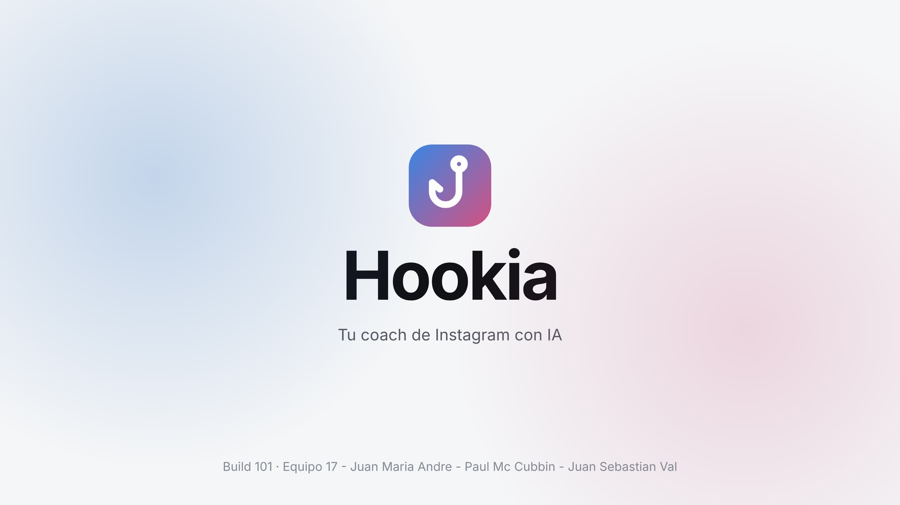
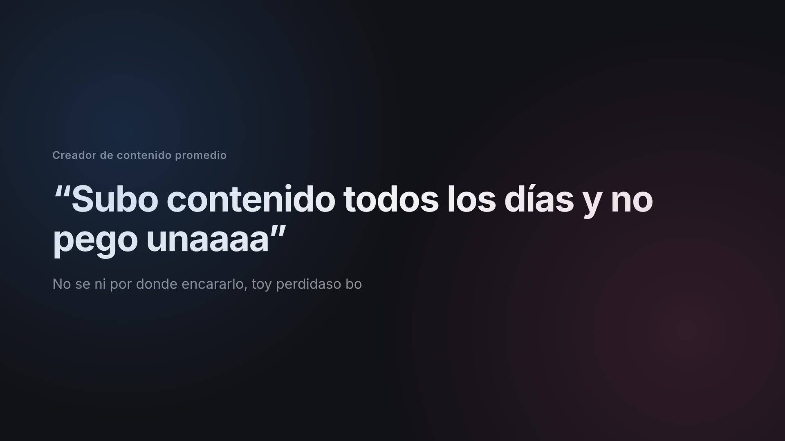
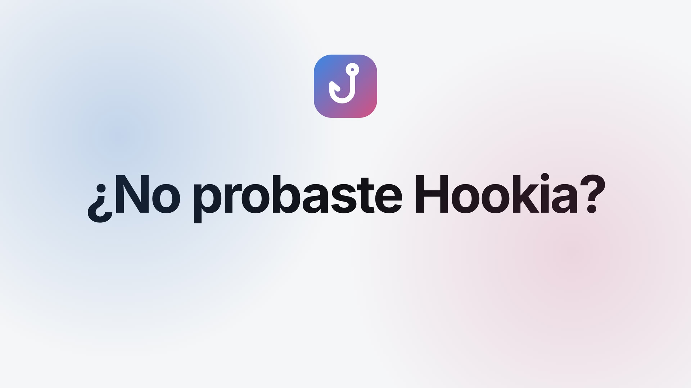
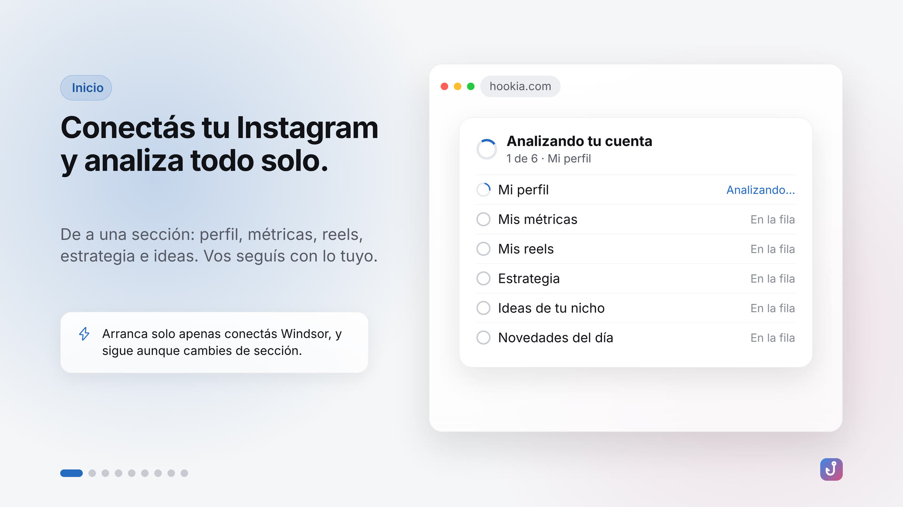
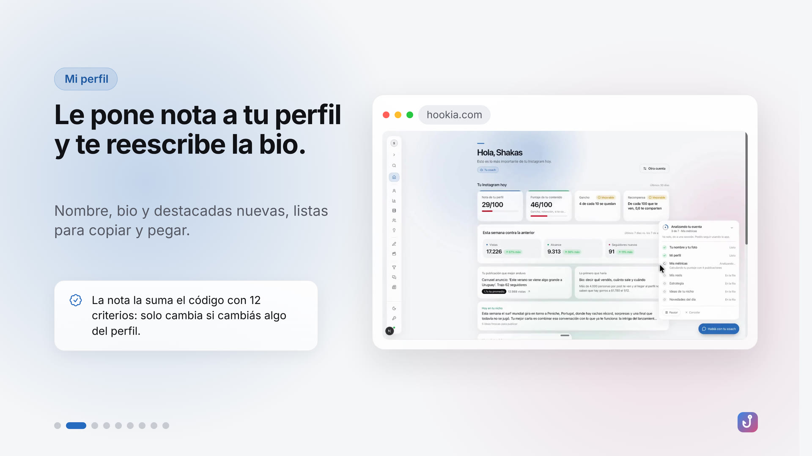
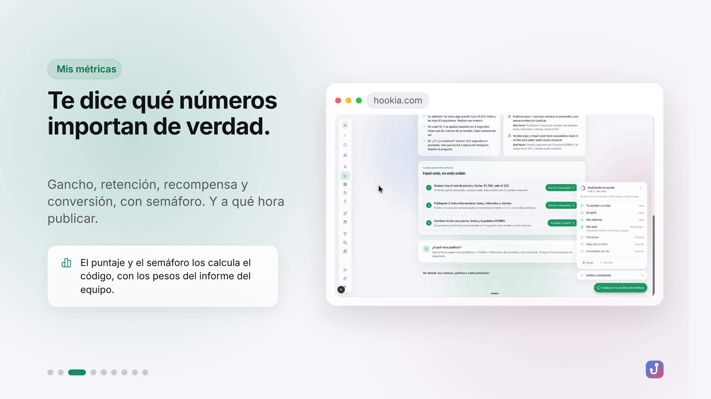
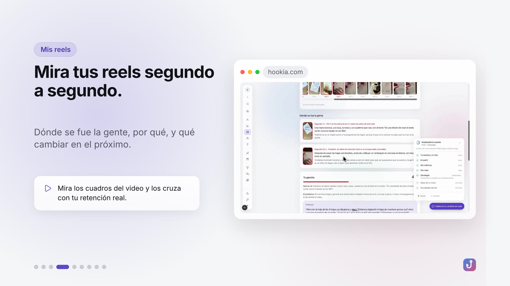
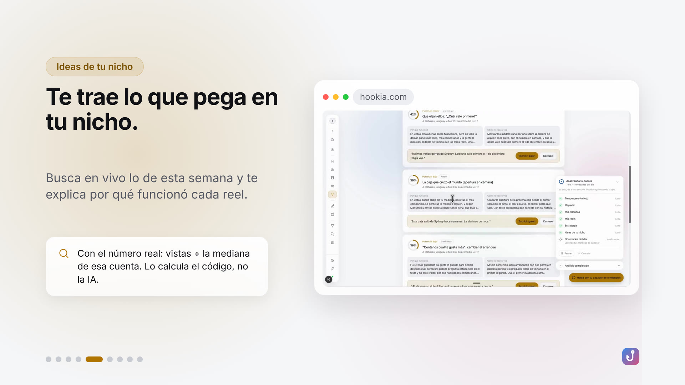
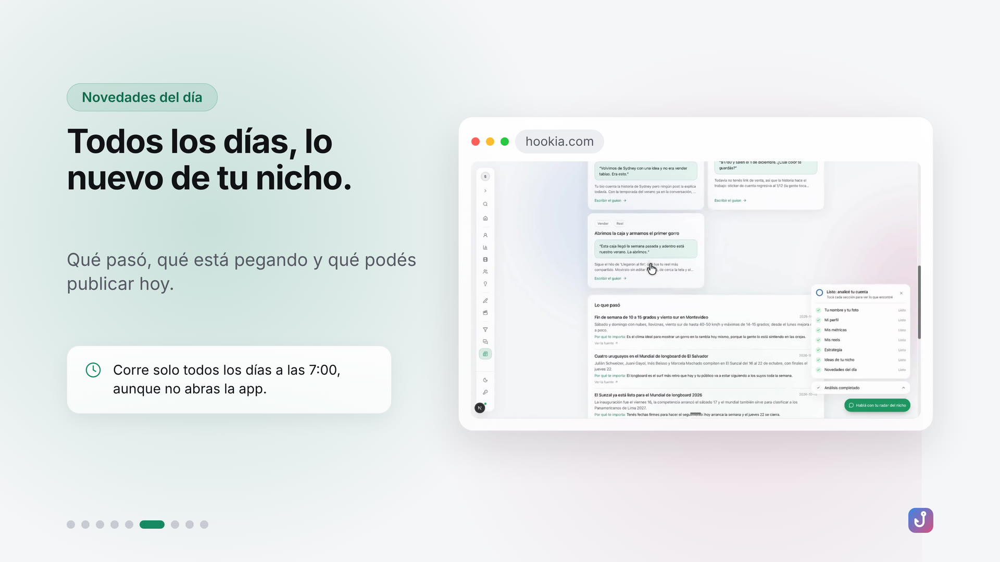
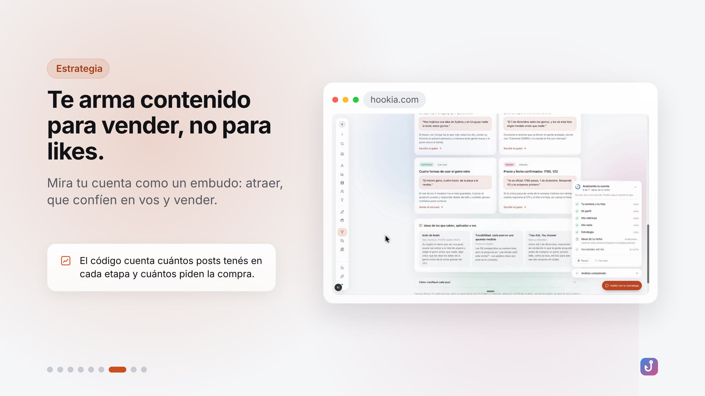
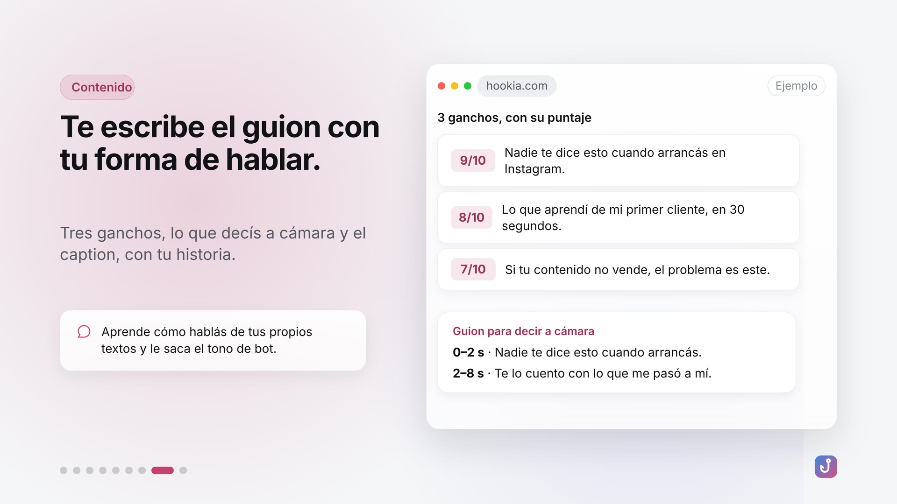
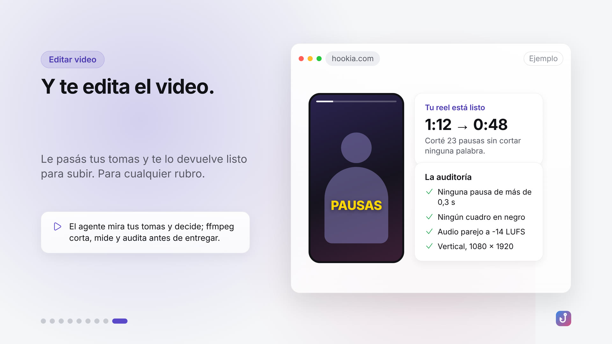
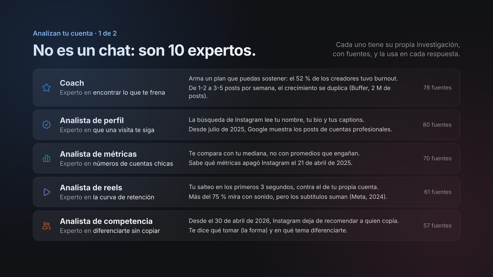
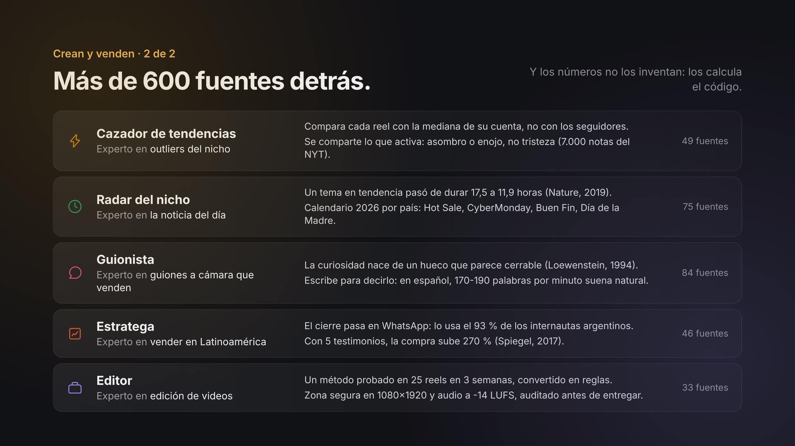
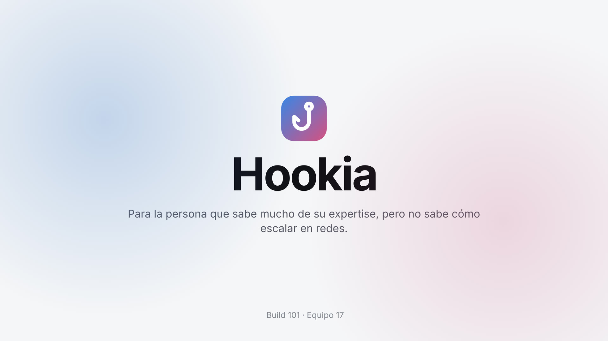
